

# SIG Vial Chaco

### GIS platform for managing the rural road network of Chaco Province, Argentina

**~29,000 km of roads · 103 maintenance consortiums · 5 zones**

🔗 **[Live demo — Hydro-meteorology section](https://sig-vial-chaco-panel.vercel.app/hidrologia/publico-85afwsdcuj)** (read-only, no account needed)

*This is a showcase repository. The source code is private; this page shows what the system does and how it was built.*

---

## The problem

In 2022, the road maintenance department of Chaco Province had **no digital data** about its rural road network: no maps, no inventory, no record of bridges or culverts. Decisions about where to work after a storm were made without knowing how much it had rained on each road.

I built this system from scratch: first the road network in QGIS (about two years of collecting and digitizing), then the apps on top of it.

## The system

| Component | Who uses it | What it does |
|---|---|---|
| **Android field app** | Field technicians | Surveys of bridges, culverts, pipes and gravel roads. Works with no signal and syncs when it reconnects. |
| **Web platform** | Office staff, engineers, management | Maps, surveys, public works calculators and budgets, equipment inventory, hydrology, user management. |
| **Public tools** | Anyone, no account | Road condition reports and roadkill wildlife reports from a phone. |

Both apps share one Supabase backend (authentication, PostgreSQL and photo storage).

---

## Screenshots

### Overview map
The whole provincial network by zone and road type, with field surveys, health and education centres as layers.

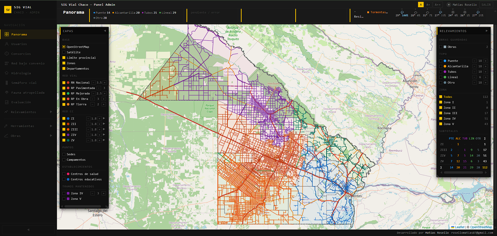

### Android field app
Used by the zone technicians on the road. Home with the network summary, the road map by zone, survey forms for each type of structure, and GPS tracking that keeps recording with the screen off.

<table>
<tr>
<td>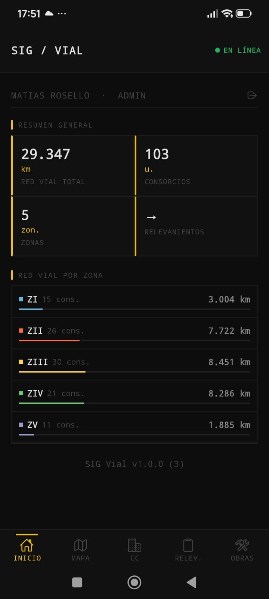</td>
<td>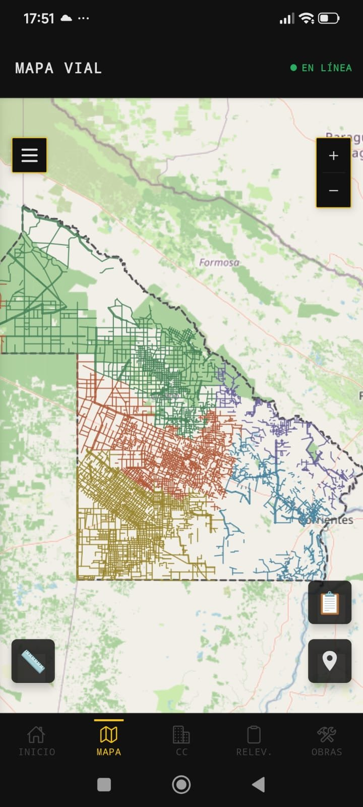</td>
<td>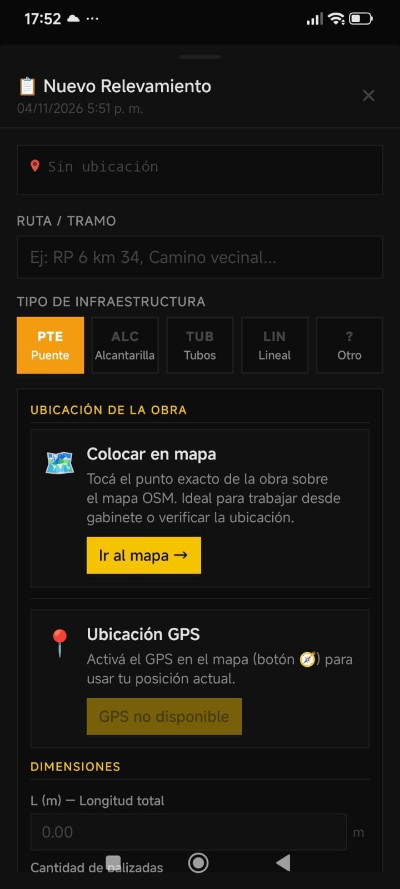</td>
<td>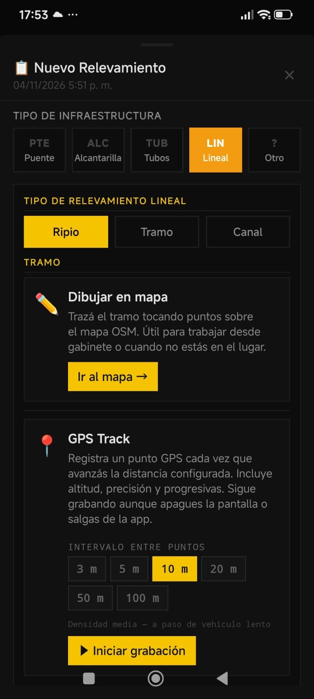</td>
<td>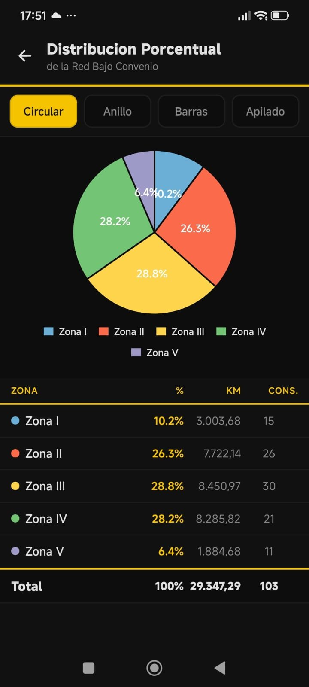</td>
</tr>
<tr>
<td align="center">Home</td>
<td align="center">Road map</td>
<td align="center">Bridge survey</td>
<td align="center">GPS track</td>
<td align="center">Network by zone</td>
</tr>
</table>

### From the field to the office
A bridge surveyed with the app, as the office sees it once it syncs: date, zone, road condition, the bridge data, its position on the map and the photos taken on site. It can be exported to KML or Shapefile, and the office can add more photos later.

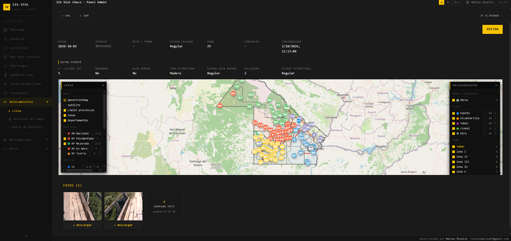

### Office surveys
Structures the technician already knows can be surveyed from the office, on satellite imagery with the road network underneath. Zone, consortium and road fill in automatically from the map, and the record is marked as an office survey so it is never confused with a measurement taken on site.

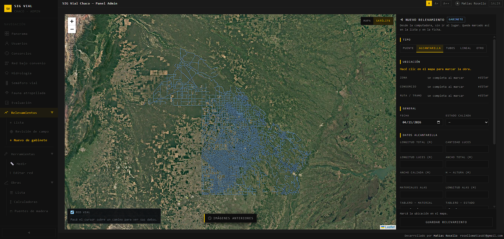

### Road network editor
The network can be edited directly in the platform, without depending on QGIS: draw new segments with snapping to existing roads, edit or remove segments, and assign them to a consortium or to the provincial agency. Each change updates the kilometres of the consortiums involved, and every map in the system shows it immediately. Changes can be exported back to QGIS as GeoJSON.

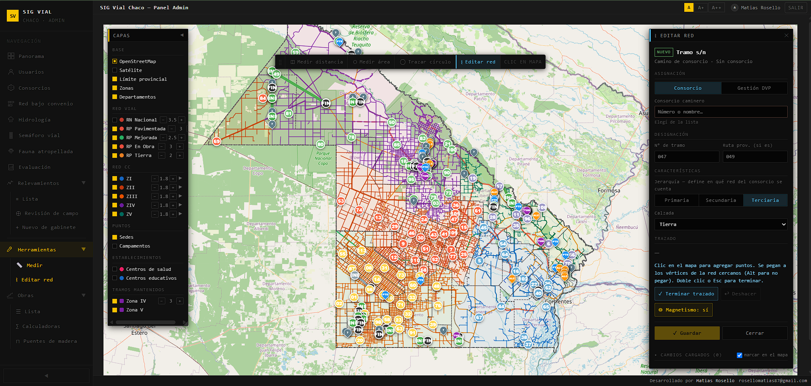

### Rainfall over the road network
Rain gauge readings (~70 stations) interpolated over every road segment, so a storm that hits one end of a consortium isn't hidden in an average.

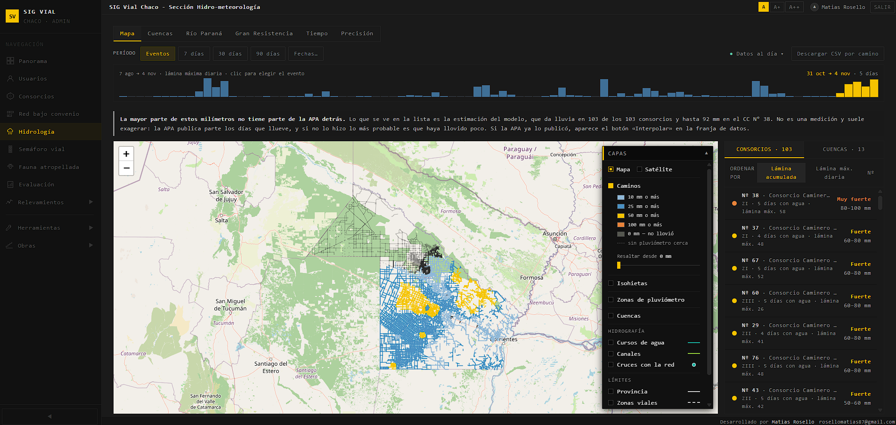

### Flood areas in Greater Resistencia
What gets flooded at each river height, built only from water actually seen in satellite images, with the flood defences and the terrain survey.

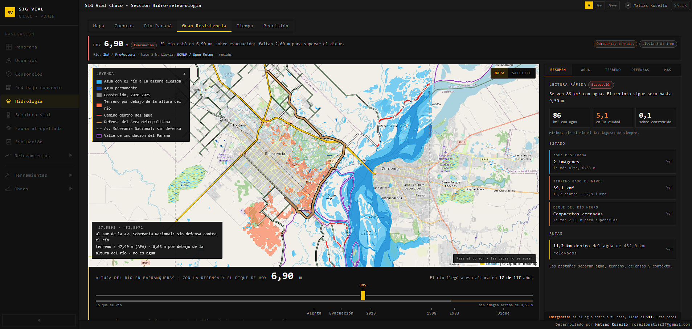

### Road network under agreement
The official 29,347 km network broken down by zone, hierarchy and road type, for each of the 103 consortiums.

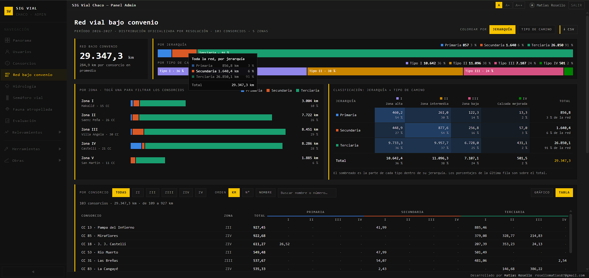

### Public works: gravel road calculator
Quantities drawn on the map, then unit price analysis, budget and a printable A4 layout, following the formal public works process.

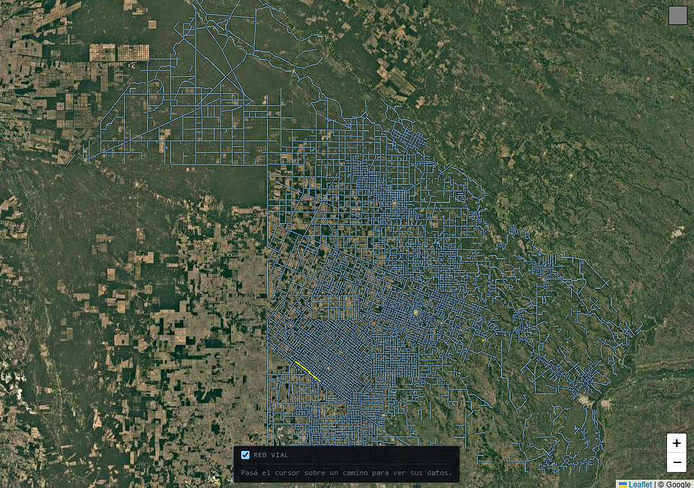

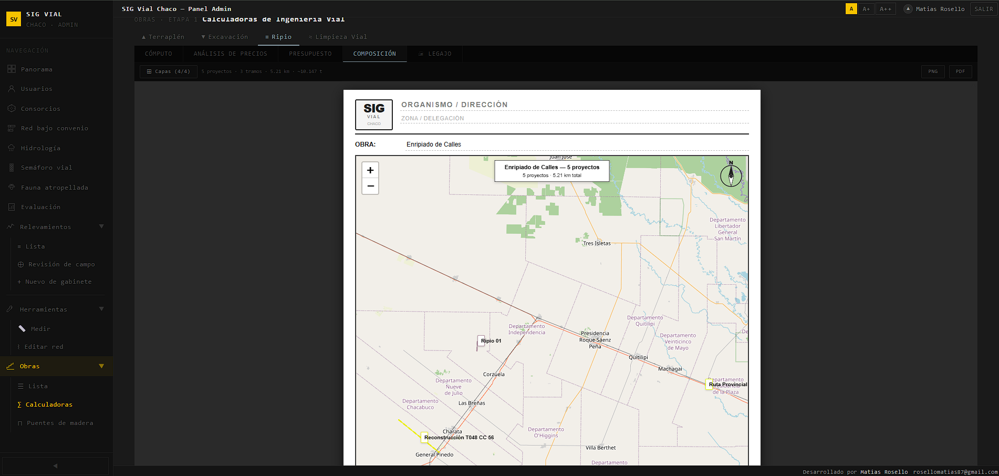

### Wooden bridges: inventory and new bridges
Every bridge surveyed with the app, with its condition from the piece-by-piece inspection, on a list and a map. From here an engineer can plan maintenance, a repair, or a brand-new bridge, with quantities and budget computed on the standard design drawings.

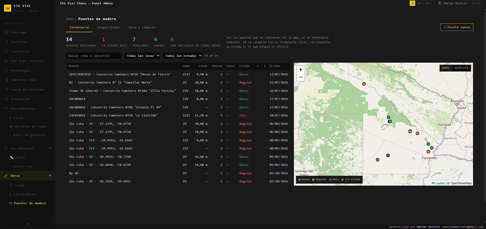

A new bridge always goes where a watercourse crosses a road, so the system offers exactly those places: **1,217 crossings** between the consortium roads and the rivers and canals, the same crossings the hydrology module uses to show where rain and water meet the network. It also warns if a surveyed bridge already exists nearby.

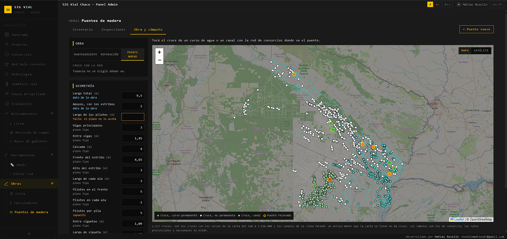

### Public reporting
Two installable web apps (PWA) are born from the same platform and shared by WhatsApp with the people who travel the network, so the road users themselves become a source of field data.

#### Road conditions
The first one, **Road Traffic Light**, lets anyone report the condition of the road where they are, with no account and from their phone, on the four-level scale of the Argentine *Rural Roads Manual*.

- The report is placed on the road network automatically, from GPS or by tapping the map.
- It works with no signal: the report waits on the phone and is sent when the connection returns.
- On the phone a report is visible for 24 hours; the office keeps the full history, can review reports before they are published, and builds condition indices from them.

<table>
<tr>
<td>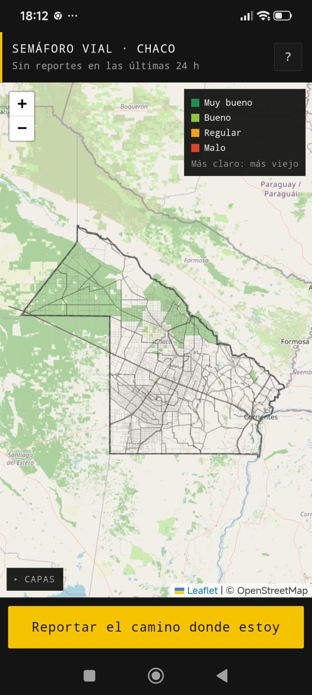</td>
<td>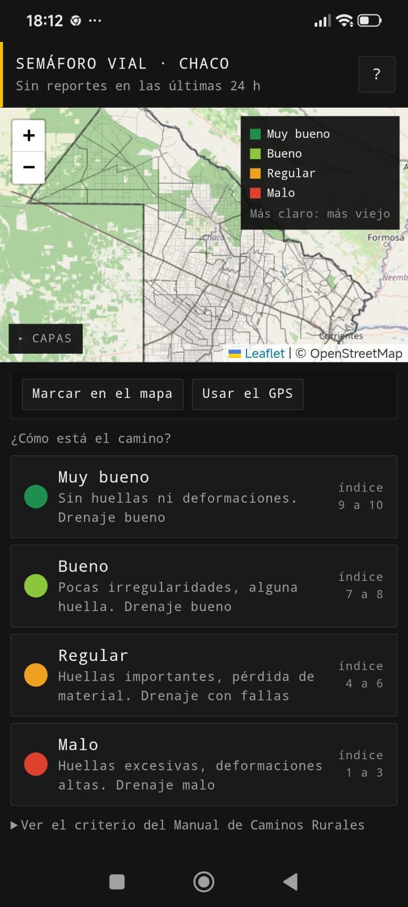</td>
</tr>
<tr>
<td align="center">Public map</td>
<td align="center">Report form</td>
</tr>
</table>

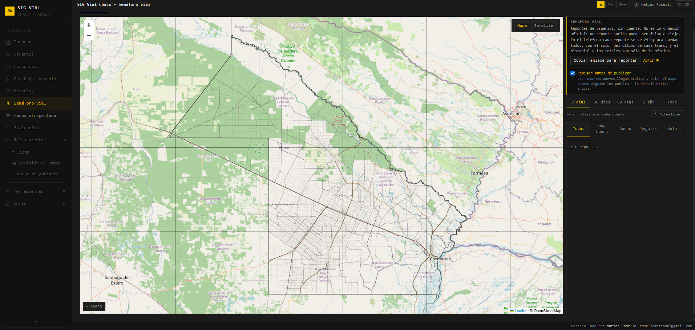

#### Roadkill wildlife
The second one lets anyone report a **native animal killed on the road**, for the area that runs roadkill surveys. The catalogue covers 48 native species or groups of the Chaco (mammals, birds, reptiles and amphibians), and "I don't know" is a valid answer: a report without a species still counts for the road segment.

- Same base as the road conditions app: no account, works with no signal, placed on the network automatically.
- Photos are never published; the office reviews and confirms the species, keeping what the reporter said alongside.
- The office gets a summary by species, zone, consortium and month, and the **critical road segments**: animals per km of road, with a clear warning that these are opportunistic records, not a systematic survey.

<table>
<tr>
<td>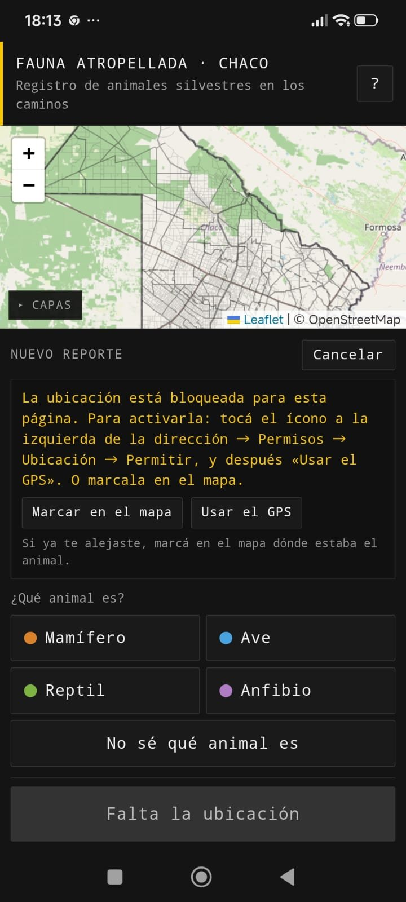</td>
<td>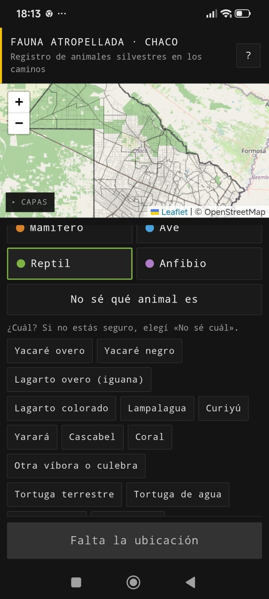</td>
</tr>
<tr>
<td align="center">New report</td>
<td align="center">Choosing the species</td>
</tr>
</table>

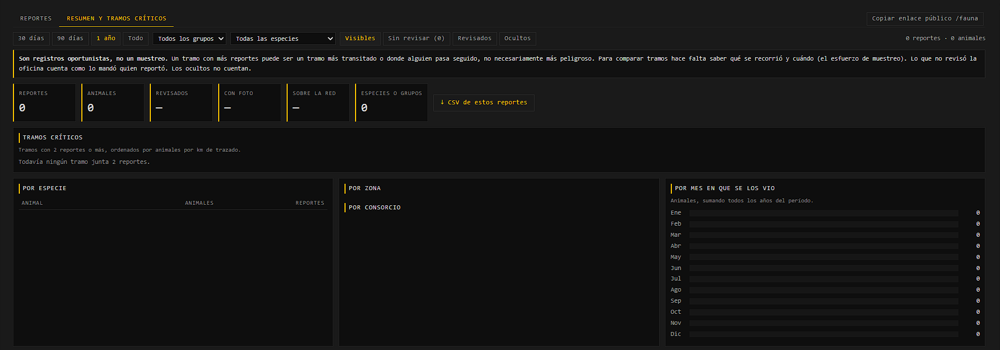

---

## Main features

**Field app**
- Leaflet map bundled in the app, so it opens with no signal.
- Background GPS tracking that keeps recording with the screen off.
- Bridge inspection form adapted from the national road agency's survey, piece by piece.
- Up to 10 photos per survey, kept safely on the phone until they upload.
- Local-first start: the app opens instantly and validates the session in the background.

**Web platform**
- Role-based permissions checked on the server for every route.
- Road network editor: add, edit and reassign road segments directly on the map.
- Equipment inventory per consortium, with Excel import and Excel/PDF export.
- Public works: gravel, embankment, excavation and canal calculators; wooden bridge inventory, inspections and budgets.
- Project evaluation for international development banks (economic analysis, environmental and social screening).

**Hydro-meteorology**
- Rainfall from provincial rain gauges, interpolated with IDW and validated by leave-one-out cross-validation.
- Paraná river levels from two official sources, with forecasts, return periods from a 120-year record, and how many days a flood takes to arrive from upstream.
- Flood forecast for Barranqueras built from rainfall in Brazil (rainfall-runoff model GR4J plus a routing function).
- Flood maps from Landsat and Sentinel-2 imagery, and wetland area by basin from Dynamic World (Google Earth Engine).
- Weather alerts from the national weather service and multi-model forecasts.

---

## How it was built

Built by one person, using **AI agents (Claude Code) as the main development tool**.

- A detailed project guide records every decision, every pitfall found and how each part is verified, so each work session builds on the previous one.
- **About 40 automated checks** compare results against cases with known answers, official figures or independent sources.
- Methods that were measured and didn't work are documented too, so nobody repeats them.

## Tech stack

| | |
|---|---|
| **Mobile** | React Native · Expo · TypeScript · Leaflet in a WebView · background location |
| **Web** | Next.js · React · TypeScript · Leaflet |
| **Backend** | Supabase (PostgreSQL, Auth, Storage, row-level security) · Vercel |
| **GIS & data** | QGIS · GeoJSON · Google Earth Engine · Landsat · Sentinel-2 · CHIRPS |
| **Data sources** | Provincial water authority · National Water Institute · Naval Prefecture · national weather service · Open-Meteo |

---

**Matías Rosello** · [GitHub](https://github.com/rikochet87) · rosellomatias87@gmail.com

